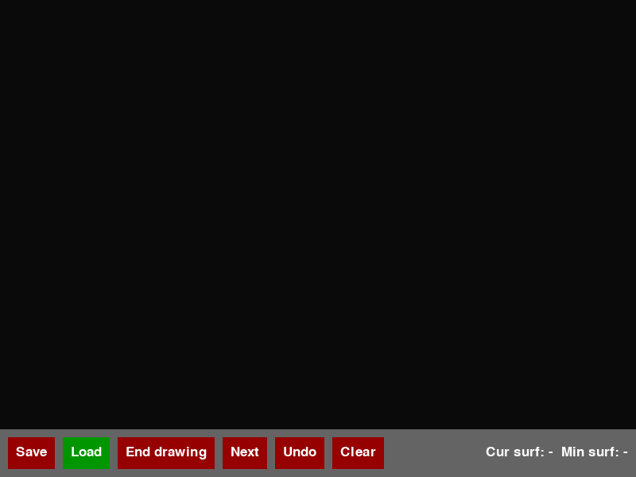

# Minimal Oriented Bounding Box Solver

An interactive Python application that computes the minimum-area oriented bounding box of a simple polygon drawn by the user, and shows step by step how the algorithm finds it.

<p align="center">
  
</p>

## Algorithm

The minimum-area rectangle enclosing a polygon has one side collinear with an edge of the polygon's convex hull (Freeman and Shapira, 1975). The program therefore:

1. computes the convex hull with Graham's scan, in O(n log n);
2. for every hull edge, finds the four extreme hull vertices along the edge and perpendicular to it, which define the rectangle aligned with that edge. Each extreme vertex is found by binary search over the hull in O(log h), so all h edges take O(h log h);
3. keeps the rectangle with the smallest area.

The total running time is O(n log n).

While the polygon is being drawn, every new edge is checked against the existing edges, so the polygon stays simple (it cannot intersect itself).

## Usage

```bash
pip install -r requirements.txt
python main.py
```

The Save and Load dialogs use Tkinter, which comes with most Python installations (on Debian/Ubuntu it is the `python3-tk` package).

* **Click** on the canvas to add a vertex. An edge that would cross an existing edge is rejected.
* **End drawing** closes the polygon. It is available (green) only when the closing edge, shown in red, does not cross the polygon.
* **Next** first shows the convex hull, then the bounding box for one hull edge per click (*Cur surf* is its area in square pixels, *Min surf* the smallest area so far), and finally the minimum bounding box.
* **Undo** removes the last vertex and **Clear** removes the polygon (while drawing).
* **Load** (before drawing) and **Save** (after drawing) read and write a polygon as a text file. [`test.txt`](test.txt) is an example polygon.
* **Esc** quits.

## Files

| File | Contents |
|---|---|
| `main.py` | pygame interface |
| `convex.py` | convex hull (Graham's scan) |
| `box.py` | bounding box aligned with a hull edge: `box2` with the O(log h) extreme-vertex search, `box` a simpler O(h) version |
| `sweep.py` | orientation test and segment intersection checks used while drawing |
